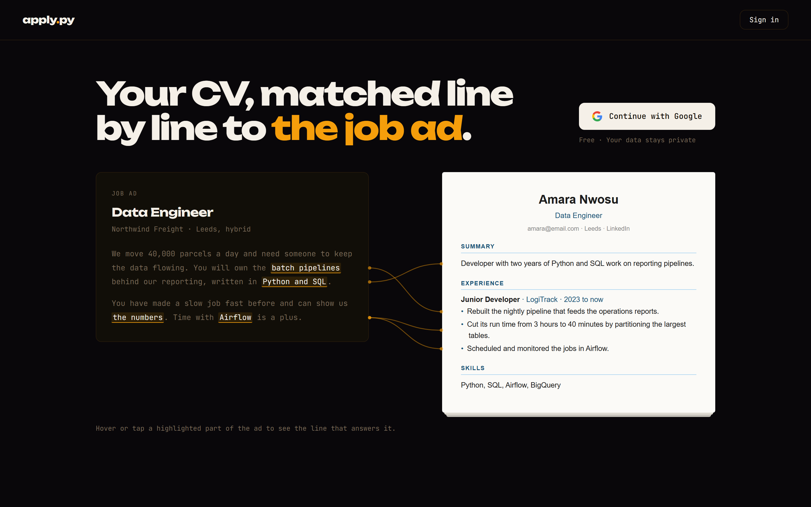
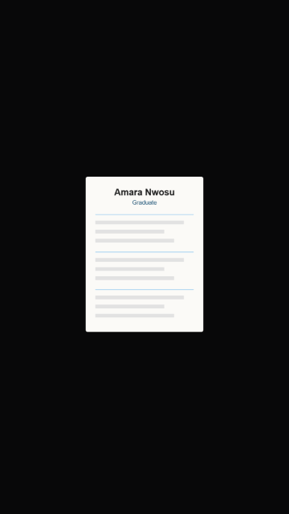

# apply.py
CV Generation, Automated



Live on this url- https://apply-py.onrender.com/_

A full-stack web app that takes any job description and generates a tailored CV and cover letter in under 60 seconds. Built with FastAPI, SQLite, Google OAuth, and the Claude API (Anthropic). Output is two formatted Word documents (.docx) zipped for download.

## Promo

<p align="center">
  
</p>

The version with sound and voiceover is [promo/promo-story.html](promo/promo-story.html): open it in Chrome or Edge and press Play.

---

## Features

- **Google OAuth sign-in** per-user accounts, no passwords
- **CV Builder** fill in your experience, skills, education, and projects once through a clean form
- **AI tailoring** paste any job description; the engine classifies the role and rewrites your CV to match
- **Smart section logic** Projects section included automatically for dev/engineering roles, skipped for support, ops, and management
- **Word document output** formatted `.docx` CV and cover letter, ready to send
- **First-time tutorial** onboarding walkthrough on first sign-in
- **Input validation** frontend + backend validation with Pydantic models, length caps, email/URL format checks
- **Security headers** X-Content-Type-Options, X-Frame-Options, Referrer-Policy on all responses

---

## Project Structure

```
apply.py/
  main.py                     # FastAPI app, routes, middleware
  database.py                 # SQLAlchemy engine + session setup
  models.py                   # User and CV database models
  dependencies.py             # JWT auth dependency (get_current_user)
  requirements.txt
  .env.example
  routers/
    auth.py                   # Google OAuth flow, /auth/me, /auth/logout
    cv.py                     # GET /cv, PUT /cv with Pydantic validation
  services/
    llm_service.py            # Claude (Anthropic) prompt + response parsing
    document_service.py       # .docx generation with python-docx
  static/
    index.html                # Single-page frontend (landing + CV builder + generate)
    favicon.svg               # SVG favicon
  outputs/                    # Generated zips land here (gitignored)
```

---

## Local Setup

### Prerequisites

- Python 3.10+
- A Google Cloud project with OAuth 2.0 credentials
- An Anthropic API key

### 1. Install Python dependencies

```bash
pip install -r requirements.txt
```

### 2. Configure environment variables

Copy `.env.example` to `.env` and fill in all values:

```bash
cp .env.example .env
```

```env
ANTHROPIC_API_KEY=your_anthropic_key_here

GOOGLE_CLIENT_ID=your_google_client_id_here
GOOGLE_CLIENT_SECRET=your_google_client_secret_here

# Any long random string
SECRET_KEY=change-this-to-something-random
```

### 3. Set up Google OAuth

1. Go to [console.cloud.google.com](https://console.cloud.google.com)
2. Create a project → APIs & Services → Credentials → Create OAuth 2.0 Client ID
3. Application type: **Web application**
4. Add this to **Authorized redirect URIs**:
   ```
   http://localhost:8000/auth/callback
   ```
5. Copy the client ID and secret into your `.env`

### 4. Run the server

```bash
uvicorn main:app --reload --port 8000
```

Open [http://localhost:8000](http://localhost:8000).

---

## How It Works

1. **Sign in** with Google account created automatically on first login
2. **Build your CV** fill in personal info, experience, skills, education, and projects via the form. Save once.
3. **Generate** paste any job description. The engine:
   - Classifies the role (dev/engineering, ops, support, security, management)
   - Tailors every section of your CV to the job
   - Writes a matching cover letter
   - Formats both as `.docx` and zips them for download

---

## API Endpoints

| Method | Path | Auth | Description |
|--------|------|------|-------------|
| `GET` | `/` | | Serves the frontend |
| `GET` | `/health` | | Health check |
| `GET` | `/auth/google` | | Starts Google OAuth flow |
| `GET` | `/auth/callback` | | OAuth callback, sets session cookie |
| `GET` | `/auth/me` | ✓ | Returns current user info |
| `POST` | `/auth/logout` | ✓ | Clears session cookie |
| `GET` | `/cv` | ✓ | Returns the authenticated user's saved CV |
| `PUT` | `/cv` | ✓ | Saves/updates the user's CV (validated) |
| `POST` | `/generate` | ✓ | Generates tailored CV + cover letter ZIP |

### POST /generate

**Request body:**
```json
{
  "job_description": "Full job description text (5015,000 chars)"
}
```

**Response:** ZIP file containing:
- `CV_RoleTitle_Company.docx`
- `CoverLetter_RoleTitle_Company.docx`

---

## Deploying to Render

> The included `render.yaml` blueprint provisions the web service and a PostgreSQL database automatically.

1. Push to GitHub
2. Create a new **Web Service** on [render.com](https://render.com)
3. Set environment variables in the Render dashboard:
   - `ANTHROPIC_API_KEY`
   - `GOOGLE_CLIENT_ID`
   - `GOOGLE_CLIENT_SECRET`
   - `SECRET_KEY`
4. Update your Google OAuth **Authorized redirect URIs** to:
   ```
   https://your-app.onrender.com/auth/callback
   ```
5. Update `allow_origins` in `main.py` to your Render domain

---

## Notes

- Documents are generated in-memory and streamed as a ZIP no files are written to disk.
- `app.db` (SQLite) is gitignored. On Render, the `render.yaml` blueprint provisions PostgreSQL via `DATABASE_URL`.
- `SameSite=Lax` cookies work on localhost without HTTPS. For production, add `secure=True` to `set_cookie` and ensure HTTPS is enforced.

## What I Learned

- How to implement Google OAuth 2.0 end to end: the authorization code flow, state validation, and securely exchanging the code for tokens inside a FastAPI callback route
- Generating formatted Word documents entirely in Python with `python-docx`, including custom XML for borders, hyperlinks, and tab stops
- Designing LLM prompts (Claude) that classify a job role and rewrite CV sections consistently, so the output is always structured enough to render
- The difference SameSite=Lax vs Secure cookies makes for OAuth redirects between local and production environments